<!-- Header Wave Animation -->

  

  <!-- Dual-Theme Monogram (Proper <picture> element avoids duplicate logo bug) -->
  

    <a href="https://www.itsmohamedwael.info" target="_blank" rel="noopener noreferrer">
      <picture>
        <source media="(prefers-color-scheme: dark)" srcset="assets/mw-logo-white.png">
        <source media="(prefers-color-scheme: light)" srcset="assets/mw-logo-dark.png">
        
      </picture>
    </a>
  

  # 👋 أهلاً، أنا محمد وائل &bull; Hey, I'm Mohamed Wael
  
  ### **AI Systems Engineer &bull; Full-Stack Architect &bull; Computer Engineering Scholar @ BUE 🎓**

  <!-- Dynamic Typing Animation -->
  

    
  

  <!-- Live Audio Waveform Pulse -->
  

    
  

  <!-- Quick Status Pill -->
  

    
  

  <!-- Navigation Action Buttons (Shields for-the-badge) -->
  

    
    
    
    
  

  <!-- Dedicated Glowing Lava Tip Button -->
  

    
  

---

## 💡 About Me & Engineering Philosophy

> *"Software shouldn't just sit passively in a browser tab. I engineer tactile systems that interact with the physical world — streaming real-time low-latency audio, driving autonomous Windows OS robotics, dispatching tickets to kitchen thermal printers, and processing high-velocity financial operations with zero downtime."*

<table width="100%">
  <tr>
    <td width="50%" valign="top">
      <h3>⚡ The Developer</h3>
      <ul>
        <li>🎓 <b>Academic Scholar:</b> Studying Computer Engineering at <b>The British University in Egypt (BUE)</b>.</li>
        <li>🧠 <b>Autonomous Agent Pioneer:</b> Specializing in multimodal AI agents, bidirectional WebSocket voice pipelines (&lt;300ms RTT), screen perception, and local DPAPI hardware security.</li>
        <li>🛠️ <b>Full-Stack Craftsmanship:</b> Architecting enterprise platforms with Next.js 15 (App Router), React 19, strict TypeScript, PostgreSQL, and modern Tailwind CSS.</li>
      </ul>
    </td>
    <td width="50%" valign="top">
      <h3>🌍 The Human</h3>
      <ul>
        <li>📍 <b>Location:</b> Cairo, Egypt &bull; Collaborating globally across US, UK, and MENA timezones.</li>
        <li>🗣️ <b>Languages:</b> Native Egyptian Arabic (اللهجة المصرية) &bull; Fluent Professional English.</li>
        <li>🎯 <b>Belief:</b> Build software with obsessive craftsmanship, zero artificial SaaS dependencies, and rock-solid local data sovereignty.</li>
        <li>☕ <b>Fuel:</b> Espresso, late-night systems programming, and high-frequency real-time architectures.</li>
      </ul>
    </td>
  </tr>
</table>

---

## 🚀 Flagship Engineering Projects

<table width="100%">
  <tr>
    <!-- Project 1: ORYVEO -->
    <td width="50%" valign="top">
      <h3 align="center">🍽️ ORYVEO — Commercial Restaurant OS</h3>
      

        
        
        
        
      

      

        Full-scale self-hosted restaurant operations platform and high-speed POS engineered for high-volume dining rooms. Runs 100% offline with zero cloud take-rates.
      

      <ul>
        <li>📱 <b>Tactile Touch POS:</b> Exact-cent split billing, multi-tender settlement, hardware PIN lock.</li>
        <li>🍳 <b>Kitchen KDS:</b> Live station dispatch, auto-rush density alerts, SLA elapsed timers.</li>
        <li>🗺️ <b>2D Floor Canvas:</b> Real-time table occupancy geometry &amp; drag-and-drop seating.</li>
        <li>🌐 <b>Bilingual Guest QR:</b> Contactless English &amp; Arabic RTL ordering with live stage tracking.</li>
        <li>🏷️ <b>Commercial Package:</b> <b>$20.00</b> — use promo code <code>ITSMOHAMEDWAEL2026</code> for <b>50% OFF ($10.00)</b>! Instant automated repository access upon checkout.</li>
      </ul>
      

        
        &nbsp;
        
      

    </td>
    <!-- Project 2: Clowdy -->
    <td width="50%" valign="top">
      <h3 align="center">☁️ Clowdy — Desktop AI Companion</h3>
      

        
        
        
        
      

      

        Next-gen autonomous desktop AI companion featuring <b>real-time bidirectional audio streaming (&lt;300ms RTT)</b>, native Egyptian dialect (العامية المصرية), authentic Arabic Maqam singing, screen perception, and deep Windows OS automation.
      

      <ul>
        <li>⚡ <b>Live Voice:</b> Full-duplex WebSocket stream with natural interruptibility.</li>
        <li>👁️ <b>Computer Vision:</b> Real-time screen frame differencing &amp; active app context.</li>
        <li>🔐 <b>Security:</b> Windows DPAPI hardware-bound credential vault.</li>
        <li>🤖 <b>OS Robotics:</b> Automates windows, launch workflows, and local system actions.</li>
      </ul>
      

        
      

    </td>
  </tr>
  <tr>
    <!-- Project 3: Interactive Portfolio -->
    <td width="50%" valign="top">
      <h3 align="center">🌐 Interactive Portfolio &amp; Aurora Engine</h3>
      

        
        
        
      

      

        Award-worthy personal portfolio featuring a <b>6-layer Aurora Borealis gradient drift</b>, physics-based mouse tracking, dynamic video showcase engine, and strict 60fps interaction rendering.
      

      <ul>
        <li>✨ <b>Kinetic Canvas:</b> Multi-layer chromatic dispersion &amp; fluid mechanics.</li>
        <li>🎯 <b>Spatial UX:</b> Interactive project cards with 3D tilt &amp; dynamic audio effects.</li>
      </ul>
      

        
      

    </td>
    <!-- Project 4: ZEN Local Brand -->
    <td width="50%" valign="top">
      <h3 align="center">👕 ZEN Local Brand — E-Commerce</h3>
      

        
        
      

      

        Bespoke digital storefront and brand identity for a premium streetwear label, designed for rapid conversion, micro-interactions, and visual storytelling.
      

      <ul>
        <li>🛍️ <b>High Conversion:</b> Tactile product drawers, instant cart preview, and responsive sizing.</li>
        <li>🎨 <b>Brand Identity:</b> Handcrafted typography, high-contrast imagery, and editorial layout.</li>
      </ul>
      

        
      

    </td>
  </tr>
</table>

---

## 🛠️ Technology Arsenal & Stack

| Domain | Technologies &amp; Frameworks |
| :--- | :--- |
| **🧠 Artificial Intelligence &amp; Vision** | `Google Gemini Live API` &bull; `PyTorch` &bull; `OpenCV` &bull; `Agentic Workflows` &bull; `WebSockets` &bull; `PyAudio` |
| **⚡ Full-Stack &amp; Web Platforms** | `Next.js 15 (App Router)` &bull; `React 19` &bull; `TypeScript 5` &bull; `Node.js 20+` &bull; `Tailwind CSS 4` &bull; `Framer Motion` |
| **💻 Systems &amp; OS Automation** | `Python 3.12+` &bull; `Windows pywin32` &bull; `DPAPI Cryptography` &bull; `C++ (Modern)` &bull; `PowerShell` &bull; `MSS Screen Capture` |
| **🗄️ Databases &amp; Infrastructure** | `PostgreSQL 16` &bull; `Redis 7` &bull; `Prisma 6 ORM` &bull; `Docker` &bull; `GitHub Actions CI/CD` &bull; `Linux (Ubuntu / Kali)` |
| **🎨 Creative UI/UX &amp; Design** | `Figma` &bull; `Design Token Systems` &bull; `Adobe Suite` &bull; `Hardware Bezel Mockups` &bull; `Touch Ergonomics` |

---

## 📊 Live GitHub Telemetry & Activity

  <table border="0">
    <tr>
      <td valign="top" width="50%">
        
      </td>
      <td valign="top" width="50%">
        
      </td>
    </tr>
    <tr>
      <td colspan="2" align="center">
        
      </td>
    </tr>
  </table>

---

## 💬 Let's Connect & Build Something Incredible

  

    Whether you are looking to architect custom <b>autonomous AI agents</b>, build an <b>ultra-fast web system</b>, or discuss high-velocity engineering, my inbox is always open:
  

  

    
    
    
    
  

   
  
  

    Crafted with passion in Cairo, Egypt 🇪🇬 &bull; Powered by code, coffee, and curiosity.
  

<!-- Footer Wave Animation -->

  

